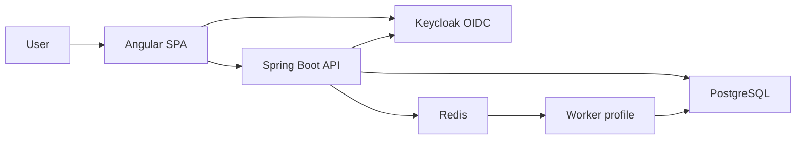

# Architecture

Taskflow is one modular monolith. The API and the worker are the same JAR with different Spring profiles. PostgreSQL is the system of record. Redis is a cache, a rate limiter, and a wake-up stream. Keycloak is identity only.

## Major components

| Process | Profile | Port | Responsibility |
|---|---|---|---|
| `frontend` | — | 4200 | Angular SPA behind nginx. Proxies `/api/` to the API. |
| `backend` | `api` | 8082 | HTTP API, authorization, tenant isolation. |
| `worker` | `worker` | 8083 | Outbox publisher, stream consumer, due-soon scan, idempotency purge. `/health` only. |
| `postgres` | — | 5433 on the host | Application data. |
| `redis` | — | 6379 | AOF, password required. |
| `keycloak` | — | 8081 on the host, 8000 in the container | Realm `taskflow`. |
| `keycloak-db` | — | not published | Keycloak's own database. |

Compose uses the default network. Published ports are bound to `127.0.0.1`.

The same processes run on Render from [render.yaml](../render.yaml). Private addresses stay inside Render. Public addresses sit beside the local ports:

| Process | Local | Render |
|---|---|---|
| Frontend | http://localhost:4200 | https://adfinance-rwanda-cates-web.onrender.com |
| API | http://localhost:8082 | https://adfinance-rwanda-cates-api.onrender.com |
| Keycloak | http://localhost:8081 | https://adfinance-rwanda-cates-auth.onrender.com |
| Postgres | localhost:5433 | Render Postgres `adfinance-rwanda-cates-db` (private) |
| Redis | localhost:6379 | Render Key Value `adfinance-rwanda-cates-redis` (private) |
| Worker | no public port | background worker `adfinance-rwanda-cates-worker` |

## Data flow

Organizations own projects. Projects own tasks. Users belong to one organization through `organization_members`, except `SUPER_ADMIN`, who has no membership. Tasks, projects, memberships, idempotency keys, and audit rows carry `organization_id`.

## Authentication flow

1. The browser opens http://localhost:4200 and starts Authorization Code with PKCE against Keycloak.
2. Keycloak authenticates the user and redirects back with a code.
3. The SPA exchanges the code for an access token. The token audience is `taskflow-api`.
4. Logout clears the local session and returns the user to Keycloak's end-session endpoint.
5. The API does not use cookies. Every protected call sends `Authorization: Bearer`.

## Request flow

1. The SPA calls `/api/**` with the bearer token.
2. The resource server checks issuer `http://localhost:8081/realms/taskflow`, audience `taskflow-api`, signature, and expiry. Inside Compose the JWKS URL is `http://keycloak:8000/realms/taskflow/protocol/openid-connect/certs`, because `localhost` inside the API container is not Keycloak.
3. The API upserts `users` from the token `sub`. It does not create a membership.
4. Tenant context comes from `organization_members`, or from `X-Organization-Id` when the token has `SUPER_ADMIN`.
5. Mutations pass the rate limiter, then a service method that checks the role, writes the row, writes audit, and enqueues an outbox row in the same transaction.
6. After commit, the API increments the dashboard version and adds a Redis stream message. The worker also polls the outbox, so a missed stream message is recovered.

## Redis usage

Redis is not the source of truth.

- Dashboard responses are cached for 60 seconds at `dashboard:{orgId}:{userId}:{scope}:{version}`. A write increments `dashboard:ver:{orgId}` so the next read misses.
- Task and member mutations use a sliding window of 60 requests per 60 seconds. Over the limit the API returns 429 and `Retry-After`. If Redis is down, the limiter allows the call and logs a warning.
- After a committed outbox row, the API appends to the `jobs` stream so the worker wakes up. The row in `job_outbox` is the queue.

Idempotency keys are in PostgreSQL, not Redis. See [ADR 004](ADR/004-redis-fail-open.md).

## Worker architecture

The worker process runs the same JAR with profile `worker`. It publishes pending `job_outbox` rows, consumes the `jobs` stream, and records each notification in `notification_deliveries` so a retry is a no-op. Failed jobs wait 5 seconds, then 15, then 45, then 2 minutes. After 5 attempts the row is `DEAD` and a copy is placed on `jobs:dlq`. A scheduled scan enqueues `TASK_DUE_SOON` once per task. Another job deletes idempotency keys older than 24 hours. The HTTP API is a separate process, so a stuck job loop does not block requests.

## Scaling considerations

Projects, tasks, authorization, and the worker share one schema and one transaction boundary. Splitting them into microservices would add network failures without a scaling problem this deployment has.

At a larger size, keep the shared schema and add read replicas for dashboard SQL, more API instances behind a load balancer, and more worker processes reading the same outbox. Tenant filters already lead with `organization_id`. Keycloak and Postgres are single nodes here; production would add their own high availability. That is documented as out of scope for this stack, not as the long-term design.

## Out of scope

One organization per ordinary user. No real email: assignment notifications are log lines. No Postgres row-level security, no Keycloak high availability, no Kafka, no Prometheus.
