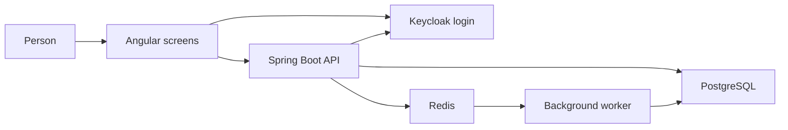

# Architecture

Taskflow is one program with two ways to start it. The API answers the browser. The worker does the slow follow-up work. They share one database. PostgreSQL holds the truth. Redis only helps. Keycloak only answers "who is this person?"

## Major components

| Process | Profile | Port | Responsibility |
|---|---|---|---|
| `frontend` | the web image | 4200 | The Angular screens. When the screen asks for `/api/`, nginx passes that to the API. |
| `backend` | profile `api` | 8082 | The HTTP API. Checks who you are, which company you belong to, and what your role allows. |
| `worker` | profile `worker` | 8083, not published | Sends assignment notices, looks for tasks due soon, and deletes old one-time keys. Only a health check is exposed. |
| `postgres` | database image | 5433 | The Taskflow data. |
| `redis` | Redis image | 6379 | Short-term memory. Password required. It keeps data across a restart. |
| `keycloak` | Keycloak image | 8081 (8000 inside the container) | The login world named `taskflow`. |
| `keycloak-db` | database image | not published | Keycloak's own database, separate from Taskflow. |

Everything shares one Docker network. The published ports listen only on this computer (`127.0.0.1`), not on the wider network.

## Data flow

A company owns projects. A project owns tasks. A person belongs to one company, except the platform owner, who belongs to none until they pick one. Projects, tasks, memberships, one-time create keys, and audit rows all carry the company id.

## Authentication flow

1. You open http://localhost:4200. The screen sends you to Keycloak. A secret for that step stays in the browser, so a stolen redirect cannot be reused by someone else. That pattern is called PKCE.
2. You type your username and password on Keycloak's page.
3. Keycloak sends the browser back with a one-time code. The screen trades that code for an access token, a short-lived proof that you signed in. The proof says it is meant for `taskflow-api`.
4. Log out throws away the local proof and also ends the Keycloak session.
5. The API does not use cookies. Each later call sends the proof in the `Authorization` header.

## Request flow

1. The screen calls `/api/...` and attaches the proof.
2. The API checks four things: the proof came from `http://localhost:8081/realms/taskflow`, it was meant for `taskflow-api`, the signature is valid, and it has not expired. Inside Docker the API fetches the signing keys from `http://keycloak:8000`, because `localhost` inside that container is not Keycloak.
3. The API records the person in `users` if this is their first call. A login does not make them a member of a company.
4. For a normal person, the company comes from their membership row. For the platform owner, it comes from the `X-Organization-Id` header after they pick a company.
5. A change is counted against the speed limit, then a service checks the role, writes the row, writes the audit line, and queues any follow-up job. Those writes succeed or fail together.
6. After the write is saved, the API bumps the dashboard version and pokes Redis so the worker wakes up. The worker also looks at the queue table on its own, so a missed poke is not a lost job.

## Redis usage

Redis is not where tasks live.

- Dashboard answers are remembered for 60 seconds. The key includes the company, the person, whether they see the whole company or only their tasks, and a version number. A write bumps that version, so the next read does not reuse the old numbers.
- Creating, editing, or deleting a task, and changing members, is limited to 60 times in 60 seconds. Past that, the API says "try again later" and tells the client how long to wait. If Redis is down, the change is still allowed and a warning is logged.
- After a job is safely stored in the database, the API adds a note on the Redis `jobs` stream so the worker wakes up. The real queue is the `job_outbox` table.

One-time create keys live in PostgreSQL. The reason is [ADR 004](ADR/004-redis-fail-open.md).

## Worker architecture

It is the same program, started with profile `worker`. It picks up waiting rows in `job_outbox`, listens for the wake-up note, and records each notice in `notification_deliveries`. That record means a retry does not send the same notice twice. A failed job waits 5 seconds, then 15, then 45, then 2 minutes. After 5 tries it is marked `DEAD` and a copy is placed on `jobs:dlq` so a person can see what failed. A timed check queues a "due soon" notice once per task. Another job deletes one-time keys older than 24 hours. The worker is a separate process, so a stuck job does not freeze the pages.

## Scaling considerations

Projects, tasks, permissions, and the worker share one database and one save boundary. Splitting them into many small services would add network failures, and this demo does not have a size problem that needs that.

If it grew, I would keep one database shape, add extra database readers for the dashboard, run more than one API behind a load balancer, and run more workers reading the same queue. Filters already start with the company id. Keycloak and PostgreSQL are each a single copy here. A real production setup would add their own standby machines. That is left out of this demo on purpose.

## Out of scope

One company per ordinary person. Notices are log lines, not email. The database does not add a second lock on every row (row-level security). Keycloak is one container. There is no separate message bus and no metrics dashboard.
