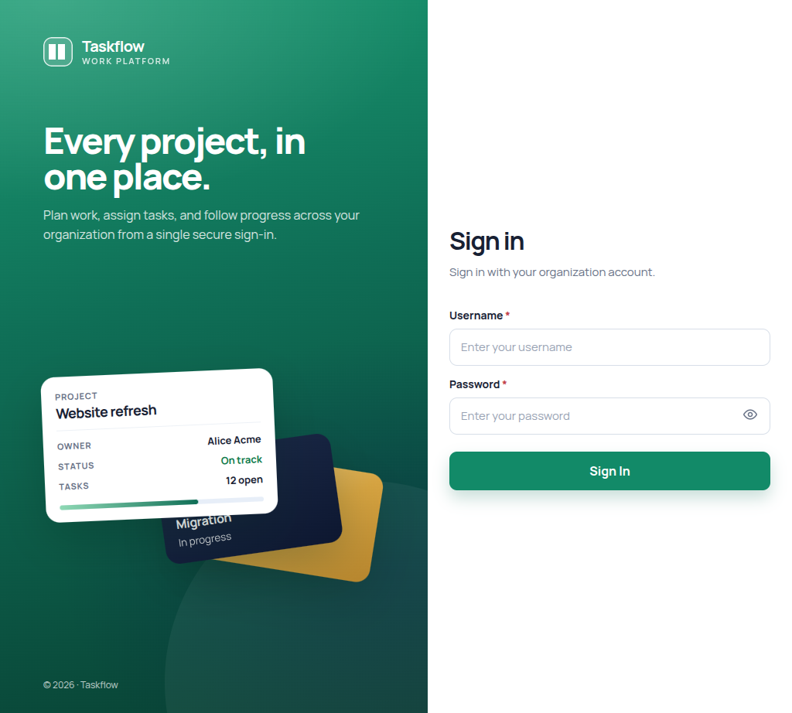
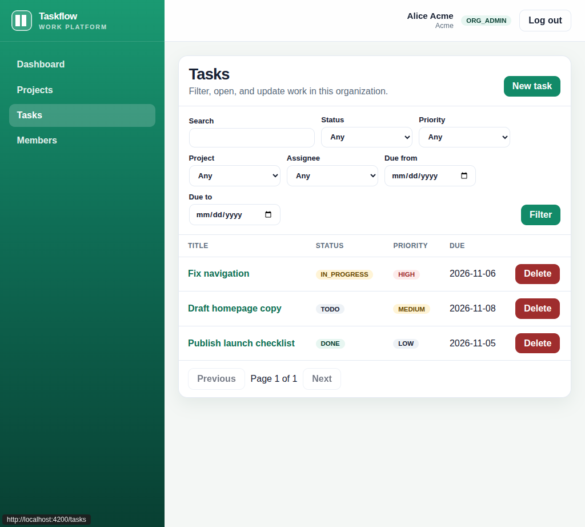
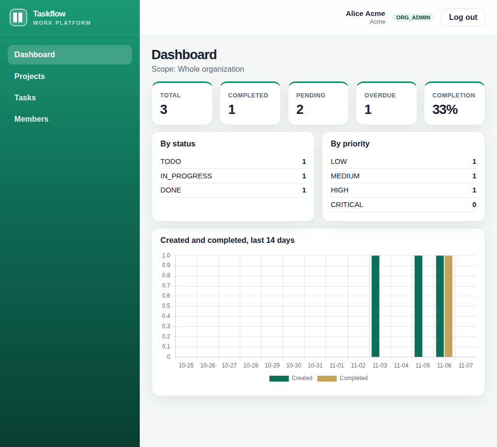

# Walkthrough

Sign in as `alice` with the password `password`. She runs Meridian. `bob` manages projects there, `cara` is a member, and `dave` runs Northline. `superadmin` has no home company until one is picked. The app is http://localhost:4200, the API is http://localhost:8082, and the login service is http://localhost:8081.

## Keycloak login

The screen sends the browser to Keycloak and gets it back with a one-time code. The API then checks that the login proof came from the right place, was meant for this API, is signed correctly, and has not expired.



## Roles and organization structure

Meridian owns the project Website refresh. Alice, Bob, and Cara are only in Meridian. Dave is only in Northline. Opening a task id from the other company looks like "not found". Asking the API for the other company's id on the query is "forbidden". The platform owner has to name a company with `X-Organization-Id` before company calls work.

## Task CRUD

The tasks screen uses the same API as the form. Creating a task needs a one-time key, so a double submit does not create two tasks. Updating a task sends the version number the screen last saw. This run created a task, updated it, and deleted it, so the three demo tasks were still there afterwards:

```text
POST /api/tasks -> 201
GET  /api/tasks/{id} -> 200  status=TODO
PUT  /api/tasks/{id} -> 200  status=IN_PROGRESS version=1
DELETE /api/tasks/{id} -> 204
```

The full lines are in [evidence/task-crud.log](evidence/task-crud.log).



## Tenant isolation

The company is the membership of the signed-in person. The browser does not get to choose it. A task is tied to both its project and its company, so a task in Meridian cannot point at a project in Northline.

## Dashboard

Alice sees the whole of Meridian. The numbers come from the database and are remembered in Redis for 60 seconds.



The dashboard call returned scope `ORGANIZATION`, total 3, completed 1, pending 2, overdue 1.

## Redis

Redis answered `PONG`. After the dashboard call, the version key for Meridian was `6`, and Alice's cached dashboard had about 60 seconds left. Speed-limit keys were there too. The one-time create keys are not in Redis. The log is [evidence/redis.log](evidence/redis.log).

## Rate limiting

Task and member changes share a window of 60 requests. Past that, the API says to wait and includes how long. If Redis is down, the change is allowed. That choice is [ADR 004](ADR/004-redis-fail-open.md).

## Concurrent updates

The update above moved `version` from 0 to 1. A second person still holding version 0 gets `409 STALE_VERSION`. They have to reload and try again. Their old copy does not overwrite the newer one.

## Audit logging

The create, update, and delete each wrote an audit row in the same save as the change. Members cannot read that list. The database refuses any later edit or delete of those rows.

## Background worker

The worker is the same program, started in worker mode. It picks up queued jobs, retries them, and after five failures marks the row `DEAD` and copies it to `jobs:dlq`.

## Automated tests

In `backend/`, `./mvnw test` runs the API against a real PostgreSQL and Redis started for the test. In `frontend/`, `npx ng test --watch=false` checks the role helpers.

## PostgreSQL backup

`./scripts/backup.sh` writes a PostgreSQL custom archive. The captured file is version 17.11, 28584 bytes, and listing it shows `organizations`, `projects`, `tasks`, `users`, and `audit_logs`. The log is [evidence/pg_dump.log](evidence/pg_dump.log).

## PostgreSQL restore

`./scripts/restore.sh backups/<file>.dump` does not stop the API for you. Stop the API and the worker first, then restore. The script replaces the existing objects and then prints how many organizations and tasks are there.

## Docker

`docker compose up --build` starts the stack.
